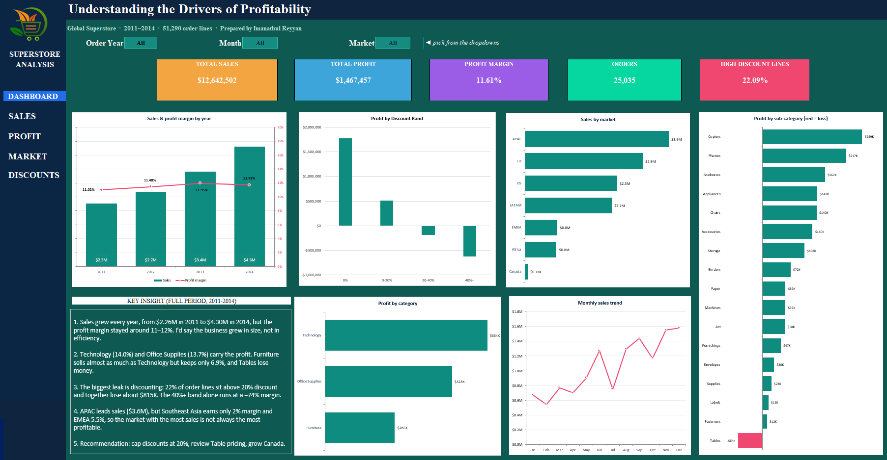

# 🛒 Global Superstore: Sales & Profit Analysis (Excel)

> **Sales doubled between 2011 and 2014, but the profit margin barely moved. Where is the money leaking?**

An end-to-end Excel analysis of 51,290 order lines from a global retailer: data cleaning, pivot tables, formulas and an interactive dashboard, with clear business recommendations.

---

## 🎯 Business questions

1. Is the business growing, and is it growing *profitably*?
2. Which categories and sub-categories make or lose money?
3. Which markets deserve more investment?
4. How much does discounting hurt profit?

## 📦 Dataset

| | |
|---|---|
| Source | [Global Super Store Dataset on Kaggle](https://www.kaggle.com/datasets/apoorvaappz/global-super-store-dataset) |
| Size | 51,290 order lines (25,035 unique orders) |
| Period | 2011 – 2014 |
| Coverage | 7 markets, 3 categories, 17 sub-categories |

> The raw CSV is not re-uploaded here. Please download it from the Kaggle link above.

## 🧹 Data preparation

- Converted `Order Date` from text (DD-MM-YYYY) into real Excel dates
- Converted the data into an Excel Table (`tblSales`) so formulas and pivots update automatically
- Added helper columns: `Order Year`, `Month`, `MonthNo`, `Discount Band`
- Every cleaning step is recorded in the **Cleaning_Log** sheet of the workbook

## 🔑 Key findings

| # | Finding | Evidence |
|---|---|---|
| 1 | **Growth without efficiency.** Sales grew 90% but margin stayed flat. | Sales $2.26M → $4.30M (2011 → 2014); margin 11.0% → 11.7% |
| 2 | **Technology and Office Supplies carry the profit.** | Margins of 14.0% and 13.7% |
| 3 | **Furniture sells a lot but keeps little.** | $4.1M sales, only 6.9% margin; **Tables lose $64K** (−8.5% margin) |
| 4 | **Discounting is the biggest leak.** | 22% of order lines (11,328) have a discount above 20% and together lose about **$815K** |
| 5 | **Deep discounts destroy profit.** | Orders with a discount of 40% or more run at a **−74% margin** |
| 6 | **Biggest market is not the most profitable.** | APAC leads on sales ($3.6M), but Southeast Asia earns 2% margin and EMEA 5.5% |

## 💡 Recommendations

- **Cap discounts at 20%.** Without the heavily discounted lines, total profit would be roughly **$2.28M instead of $1.47M**.
- **Review Table pricing and costs**, since this sub-category loses money at any volume.
- **Push Technology and Office Supplies**, where each sale is worth more.
- **Investigate low-margin regions** (Southeast Asia, EMEA) before spending more to grow sales there.

## 🛠️ What's inside the workbook

| Sheet | Purpose |
|---|---|
| `Dashboard` | Interactive dashboard with Year, Month and Market filters |
| `Pivot_*` | Pivot tables by year, category, market and discount band |
| `Calc` | Formulas that power the KPI tiles and charts |
| `Data` | Cleaned dataset |
| `Cleaning_Log` | Record of every cleaning step |

**Excel skills used:** Tables, PivotTables and PivotCharts, SUMIFS / COUNTIFS, GETPIVOTDATA, data validation dropdowns, combo and donut charts, dashboard design.

## ▶️ How to use

1. Download `Global_Superstore_Analysis.xlsx`
2. Open the `Dashboard` sheet
3. Use the **Year**, **Month** and **Market** dropdowns at the top; every KPI and chart updates

## 👩‍💻 Author

**Imanathul Reyyan**: BSc Applied Data Analytics, University of Colombo
🔗 [LinkedIn](https://www.linkedin.com/in/imanathul-reyyan) · 🌐 [Portfolio](https://imanathulreyyan.github.io) · ✉️ imanareyyan@gmail.com

*Project 1 of 19 in my data analytics portfolio (Excel → SQL → Power BI → combined projects).*
